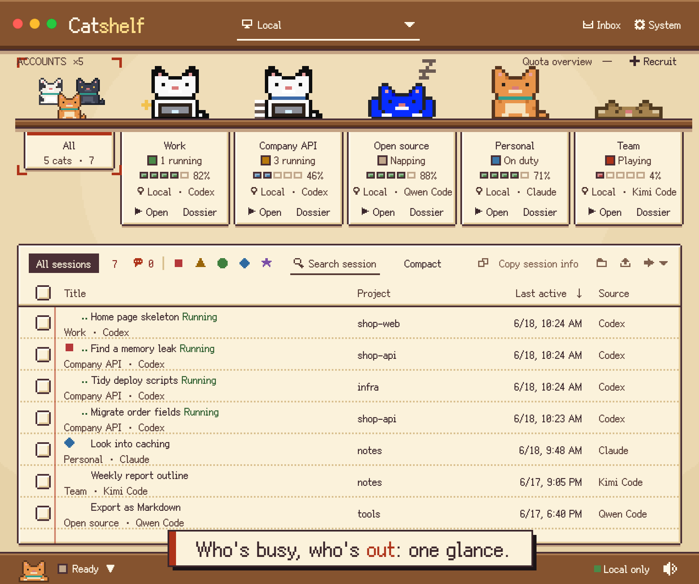
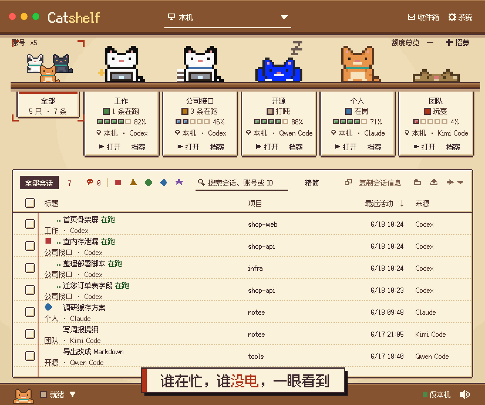

<p align="center">
  
</p>

<h1 align="center">Catshelf</h1>

<p align="center"><strong>All your AI coding accounts and their sessions in one window: one pixel cat per account.</strong></p>

<p align="center">
  <a href="LICENSE"></a>
  
  
</p>

<p align="center"><a href="#catshelf猫架中文说明">中文说明</a></p>

<p align="center">
  
</p>

<p align="center">
  <a href="https://github.com/shuqianglin1997/catshelf/releases/latest/download/Catshelf-unsigned-universal.dmg"><strong>Download for macOS</strong></a> · Apple silicon and Intel, <code>.dmg</code>
  <br />
  <a href="https://github.com/shuqianglin1997/catshelf/releases/latest/download/Catshelf-unsigned-portable-x64.exe"><strong>Download for Windows</strong></a> · 64-bit, portable <code>.exe</code>
  <br />
  <sub>The newest unsigned test build · checksums: <a href="https://github.com/shuqianglin1997/catshelf/releases/latest/download/SHA256SUMS.txt">SHA256SUMS.txt</a> · <a href="https://github.com/shuqianglin1997/catshelf/releases">all releases</a></sub>
</p>

https://github.com/user-attachments/assets/3f651fb3-d9c0-4092-bec9-6f85c5f69fac

<p align="center"><sub>Catshelf launch film, about one minute · <a href="https://github.com/user-attachments/assets/e5493d17-6f91-427a-b89d-bc2af3a7787e">中文</a></sub></p>

The first time you open it, the system stops it because it is not signed yet. **macOS:** after the warning, open System Settings → Privacy & Security and click **Open Anyway** next to the message about Catshelf. **Windows:** at the SmartScreen prompt choose **More info**, then **Run anyway**. Do not use other workarounds.

Catshelf (Chinese 猫架; formerly AgentDesk) is a desktop app for macOS and Windows. It keeps the AI coding clients you already use (Claude, Claude CLI, Codex, Cursor, Kimi Code, Kimi Work, DSH, OpenCode, Gemini CLI, Qwen Code, Antigravity — only the one account signed in on the computer), each of your accounts on them, and their local session history in one window. It opens the official client for the account you pick. It does not run agents itself, and it never stores passwords or tokens.

## Status

The source is version `0.10.1-preview.1`, a Preview. The downloads above are unsigned test builds that GitHub builds from a tagged commit; there is no public Preview matching this source yet (signed and notarized). How both kinds are released, and what a signed Preview must pass first, is in [docs/RELEASING.md](docs/RELEASING.md). What has been checked, and how, is in the [validation ledger](docs/VALIDATION.md). Personal Mesh is attended only; public NAT/TURN, disconnect recovery and the macOS/Windows permission matrix are still open.

## Install

- **macOS:** open the DMG, drag Catshelf into Applications and open it from there. Do not install the old v0.9.0 macOS image; Apple reports that unsigned package as revoked.
- **Windows:** run the `.exe` directly; it installs nothing. Store/MSIX paths are in [docs/WINDOWS.md](docs/WINDOWS.md).
- **Checksum:** compare the file's SHA-256 with `SHA256SUMS.txt`: `shasum -a 256 Catshelf-unsigned-universal.dmg` on macOS, `Get-FileHash .\Catshelf-unsigned-portable-x64.exe` in PowerShell.

Your accounts, settings and device keys live in a data folder that keeps the old name: `~/Library/Application Support/AgentDesk` on macOS, `%APPDATA%\AgentDesk` on Windows. A new version does not touch it.

## Let your AI set up your accounts

Catshelf has its own command line, so the AI you already use on this computer (Codex, Claude, GPT…) can find, register and check your accounts for you. Copy this to it as one message:

```text
Help me set up my accounts in Catshelf, an open-source desktop app that keeps AI coding accounts in one window.
- Source and docs: https://github.com/shuqianglin1997/catshelf. Read docs/AI_INTERFACE.md there before doing anything.
- Its command line opens no window:
  macOS:   /Applications/Catshelf.app/Contents/MacOS/Catshelf --cli <command words and options>
  Windows: the portable .exe I downloaded is a GUI program, so write the answer to a new file and read it:
    Start-Process -FilePath "<path to Catshelf-unsigned-portable-x64.exe>" -ArgumentList @('--cli', <command words and options>, '--output', '"<new absolute .json path>"') -Wait
- Start with `capabilities`, then `apps` and `profiles discover`. Register what I choose with `profiles register`, or make a new separate account with `profiles create`. Ask me before every change and use the exact ids it returns.
- Keys and sign-ins: never ask me to paste a key or token into this chat, and never put one in a command argument. I either paste it into Catshelf's own window (Recruit), or on macOS I copy it and you run `pbpaste | <the macOS path above> --cli profiles set-key --profile <id>`, which reads it from standard input. Signing in happens in the official client. Check the result with `profiles status --profile <id>`.
- If anything fails, run `diagnostics` and show me what it says.
```

## If something goes wrong

Run the package's own diagnostics (no window opens):

```bash
/Applications/Catshelf.app/Contents/MacOS/Catshelf --cli diagnostics
```

On Windows, use `--output` as shown in [docs/FIX_AND_REBUILD.md](docs/FIX_AND_REBUILD.md). It prints the version and the exact commit this copy was built from, the system, where the data folder and the log are (`~/Library/Logs/Catshelf` on macOS, `%APPDATA%\AgentDesk\logs` on Windows), the last log lines and a few self-checks. It contains no keys, tokens, session contents or account names, and your home folder shows as `~`. On macOS, **About Catshelf** also shows the version and commit.

Hand that and what happened to your AI assistant: [docs/FIX_AND_REBUILD.md](docs/FIX_AND_REBUILD.md) tells it what to check when Catshelf does not open at all, how to fetch exactly that source, fix the problem, and build and install a new copy on your computer without touching your data. Or put it into an issue.

## What it does

- **Accounts as cats.** Each account is a cat on a shelf, with its activity (working, waiting, resting), five quota pips and the one thing it needs from you. Pick a cat to see its sessions, or **All**.
- **Add accounts four ways** (Recruit): a new isolated account signed in through the official client; bring back accounts already on this computer; drop a data folder or sign-in file; or let an AI do it through the command line. Pasted keys go straight to that account's own client.
- **One session list.** Search and sort local sessions from every client. Copy session info (path and coordinate only), open the folder, export as Markdown, mark new replies and colour tags. Compaction and sub-agent records never show up as extra sessions.
- **Several accounts per client.** Each account has its own data folder, so work and personal sign-ins don't collide; the same login used by a desktop app and a CLI stays one cat.
- **Your other computers (attended).** Pair your own devices, see their sessions, send a session's location or files, hand a whole task over as an encrypted package, and view or control another screen with consent on that screen.
- **Background runs, only when you allow them.** An AI working in one of your accounts can ask Catshelf to relay a run to another account you switched on. Catshelf never starts, queues or schedules runs by itself.
- **Tools and diagnostics.** See which clients and CLIs are installed, update a CLI when you click, and inspect launch paths and data locations.

## What it does not do

It does not embed a chat or terminal, run task queues or orchestrate agents, register arbitrary commands, offer a remote shell, or store passwords, tokens or browser credentials. Sign-in stays inside the official clients. The window runs with context isolation, no Node integration and the Chromium sandbox; files and processes are handled only by the main process.

## Build from source

You need no GitHub account and nothing from GitHub's build service: `git clone https://github.com/shuqianglin1997/catshelf.git`, or **Code → Download ZIP** on this page. You need Node.js 22.12 or newer. `npm ci` downloads the dependencies and Electron (from npm and GitHub's public downloads, without an account); the first packaging run also downloads electron-builder's own tools. macOS needs the Xcode command line tools (`xcode-select --install`). Windows needs Visual Studio Build Tools with “Desktop development with C++”: packaging compiles a small native helper with MSVC.

```bash
npm ci
npm start              # run from source
npm test               # all Node tests
npm run check          # syntax and type check
npm run check:docs     # documentation and validation ledger

npm run build:mac:dir  # app for this Mac: release/mac-arm64/Catshelf.app (Intel: release/mac/)
npm run build:mac:test # universal DMG: release/Catshelf-<version>-universal.dmg
npm run build:win      # Windows portable: release/Catshelf-<version>-portable-x64.exe
```

A build you make is for your own computer: it is not notarized by Apple (macOS gets an ad-hoc signature, Windows none). On the computer that built it, it usually opens without a prompt; if the system stops it, allow it the same way as above. `npm run install:mac:local -- --source <the .app>` puts a macOS build into Applications ([docs/FIX_AND_REBUILD.md](docs/FIX_AND_REBUILD.md)). The signed build (`npm run build:mac`) needs the project's credentials; what this project publishes, and how, is in [docs/RELEASING.md](docs/RELEASING.md).

## For AI assistants

- Fixing a problem for someone who installed Catshelf: start with `--cli diagnostics`, then [docs/FIX_AND_REBUILD.md](docs/FIX_AND_REBUILD.md).
- Using Catshelf from the command line (accounts, sessions, background runs): [docs/AI_INTERFACE.md](docs/AI_INTERFACE.md), starting with `--cli capabilities` on a package or `node src/automation/cli.js capabilities` in the source.
- Changing the code: [AGENTS.md](AGENTS.md) and [docs/STRUCTURE.md](docs/STRUCTURE.md). Only the owner pushes to this repository.

## Documentation

Start at the [documentation map](docs/README.md). Product facts: [docs/PRODUCT.md](docs/PRODUCT.md). Code: [docs/STRUCTURE.md](docs/STRUCTURE.md) and [docs/INTERNAL.md](docs/INTERNAL.md). Devices and Personal Mesh decisions: [docs/PERSONAL_AGENT_MESH_PLAN.md](docs/PERSONAL_AGENT_MESH_PLAN.md). The rename and the names that must not change: [docs/RENAME_PLAN.md](docs/RENAME_PLAN.md).

## License

[MIT](LICENSE) © hupo. The bundled Fusion Pixel font is under the SIL Open Font License (see `assets/fonts/`). Client names and colours only indicate which client a cat belongs to; they are not logos and imply no affiliation with those vendors.

---

# Catshelf（猫架）中文说明

<p align="center">
  
</p>

<p align="center">
  <a href="https://github.com/shuqianglin1997/catshelf/releases/latest/download/Catshelf-unsigned-universal.dmg"><strong>下载 macOS 版</strong></a> · Apple 芯片与 Intel 通用，<code>.dmg</code>
  <br />
  <a href="https://github.com/shuqianglin1997/catshelf/releases/latest/download/Catshelf-unsigned-portable-x64.exe"><strong>下载 Windows 版</strong></a> · 64 位，免安装 <code>.exe</code>
  <br />
  <sub>最新的未签名测试版 · 校验和：<a href="https://github.com/shuqianglin1997/catshelf/releases/latest/download/SHA256SUMS.txt">SHA256SUMS.txt</a> · <a href="https://github.com/shuqianglin1997/catshelf/releases">全部发布</a></sub>
</p>

https://github.com/user-attachments/assets/e5493d17-6f91-427a-b89d-bc2af3a7787e

<p align="center"><sub>猫架发布短片，约一分钟 · <a href="https://github.com/user-attachments/assets/3f651fb3-d9c0-4092-bec9-6f85c5f69fac">English</a></sub></p>

第一次打开时，因为还没有签名，系统会把它拦下。**macOS：**看到提示后，打开“系统设置 → 隐私与安全性”，在关于 Catshelf 的那条提示旁点“仍要打开”。**Windows：**SmartScreen 提示时点“更多信息”，再点“仍要运行”。不要用别的办法绕过。

猫架（Catshelf，原名 AgentDesk）是 macOS 和 Windows 上的桌面应用：把你已经在用的 AI 编程客户端（Claude、Claude CLI、Codex、Cursor、Kimi Code、Kimi Work、DSH、OpenCode、Gemini CLI、Qwen Code、Antigravity——只能用这台电脑上登录的那一个账号）、你在它们上面的每个账号，以及本机的会话记录放进同一个窗口。选一个账号就打开它的官方客户端。猫架自己不跑 Agent，也不保存密码和令牌。

## 现在的状态

源码版本是 `0.10.1-preview.1`，属于 Preview。上面的下载是 GitHub 按打了标签的提交打出的未签名测试版；与这份源码对应、签名并公证的公开 Preview 还没有。两种包怎么发、签名的 Preview 先要过哪些门禁，见 [docs/RELEASING.md](docs/RELEASING.md)。做过哪些检查、怎么做的，记在[验证记录](docs/VALIDATION.md)。设备网只做有人值守；公网 NAT/TURN、断网恢复和 macOS/Windows 权限矩阵仍未完成。

## 安装

- **macOS：**打开 DMG，把 Catshelf 拖进“应用程序”，再从那里打开。不要安装旧的 v0.9.0 macOS 镜像（苹果已将这个未签名的包标为吊销）。
- **Windows：**直接运行 `.exe`，不需要安装。Store/MSIX 的路径说明见 [docs/WINDOWS.md](docs/WINDOWS.md)。
- **校验：**把文件的 SHA-256 和 `SHA256SUMS.txt` 对一下：macOS 用 `shasum -a 256 Catshelf-unsigned-universal.dmg`，Windows 在 PowerShell 里用 `Get-FileHash .\Catshelf-unsigned-portable-x64.exe`。

账号、设置和设备网的钥匙放在沿用旧名的数据目录里：macOS 是 `~/Library/Application Support/AgentDesk`，Windows 是 `%APPDATA%\AgentDesk`。换新版本不会动它。

## 让你的 AI 帮你配置账号

猫架自带命令行，你电脑上已经在用的 AI（Codex、Claude、GPT 等）可以替你找到、登记和检查账号。把下面这段整段发给它：

```text
请帮我在猫架（Catshelf）里配置账号。它是一个开源的桌面应用，把 AI 编程账号放进同一个窗口。
- 源码和文档：https://github.com/shuqianglin1997/catshelf。动手之前先读里面的 docs/AI_INTERFACE.md。
- 它的命令行不会打开窗口：
  macOS：/Applications/Catshelf.app/Contents/MacOS/Catshelf --cli <命令和参数>
  Windows：我下载的 portable .exe 是图形程序，要把结果写进一个新文件再读：
    Start-Process -FilePath "<Catshelf-unsigned-portable-x64.exe 的路径>" -ArgumentList @('--cli', <命令和参数>, '--output', '"<新的 .json 绝对路径>"') -Wait
- 先跑 `capabilities`，再跑 `apps` 和 `profiles discover`。我选中的用 `profiles register` 登记，要新的独立账号用 `profiles create`。每次改动前先问我，用它返回的确切编号。
- 密钥和登录：不要让我把密钥或令牌贴进这个对话，也不要把它写进命令参数。要么我在猫架自己的窗口里（招募）粘贴；要么在 macOS 上我先复制，你运行 `pbpaste | <上面的 macOS 路径> --cli profiles set-key --profile <编号>`，它从标准输入读。登录在官方客户端里完成。用 `profiles status --profile <编号>` 核对结果。
- 出了错就跑 `diagnostics`，把结果给我看。
```

## 用着出了问题

运行安装包自带的诊断（不会打开窗口）：

```bash
/Applications/Catshelf.app/Contents/MacOS/Catshelf --cli diagnostics
```

Windows 上照 [docs/FIX_AND_REBUILD.md](docs/FIX_AND_REBUILD.md) 的写法加 `--output`。它会写出这份程序的版本和确切的提交号、系统、数据目录和日志在哪（macOS 是 `~/Library/Logs/Catshelf`，Windows 是 `%APPDATA%\AgentDesk\logs`）、日志最后几行和几项自检。里面没有密钥、令牌、会话内容和账号名，主目录写成 `~`。macOS 的“关于 Catshelf”里也有版本号和提交号。

把这些和出了什么问题一起交给你的 AI 助手：[docs/FIX_AND_REBUILD.md](docs/FIX_AND_REBUILD.md) 告诉它猫架根本打不开时查什么、怎么取回同一份源码、修好问题，再在你的电脑上打包装好，不动你的数据。也可以写进 issue。

## 能做什么

- **一个账号一只猫。** 猫坐在搁板上，姿势和状态灯说它在干活、在等还是在休息，五格能量是可信的额度，名牌下面写着它需要你做的一件事。点一只猫看它的会话，点“全部”看所有会话。
- **四种方式招募账号：** 新来一只（新建独立账号，在官方客户端里登录）、把已有的领回来、把数据目录或登录文件拖进来、交给 AI 用命令行办。粘贴的密钥直接交给那个账号自己的客户端。
- **一张会话表。** 搜索、排序各客户端的本机会话；复制会话信息（只有路径和坐标）、打开目录、导出 Markdown；标出新回复、打颜色标签。上下文压缩和子代理的记录不会变成多出来的会话。
- **一个客户端多个账号。** 每个账号有自己的数据目录，工作号和个人号互不覆盖；同一个登录的桌面版和命令行版仍是一只猫。
- **你的其他电脑（有人值守）。** 配对自己的设备，查看它们的会话，发送会话位置或文件，把一整件事打成加密任务包交出去；查看或控制另一台电脑的屏幕需要那台电脑当场同意。
- **后台对话，只在你允许时。** 你在某个账号里用的 AI 可以通过猫架请你打开过开关的另一个账号在后台跑一段对话；猫架自己从不发起、排队或定时。
- **工具与诊断。** 看装了哪些客户端和命令行工具，点一下才更新命令行工具，查看启动路径和数据位置。

## 不做什么

不内嵌聊天或终端，不做任务队列或 Agent 编排，不登记任意命令，不提供远程 Shell，不保存密码、令牌或浏览器凭据。登录留在官方客户端里。窗口开启上下文隔离、关闭 Node 集成并启用 Chromium 沙箱，文件和进程只由主进程处理。

## 从源码构建

不需要 GitHub 账号，也不需要 GitHub 的打包服务：`git clone https://github.com/shuqianglin1997/catshelf.git`，或者在这个页面点 “Code → Download ZIP”。需要 Node.js 22.12 或更新。`npm ci` 会联网下载依赖和 Electron（来自 npm 和 GitHub 的公开下载地址，不需要账号）；第一次打包时 electron-builder 还会下载它自己的打包工具。macOS 需要 Xcode 命令行工具（`xcode-select --install`）；Windows 需要 Visual Studio Build Tools 里的“使用 C++ 的桌面开发”，打包时要用 MSVC 编译一个小的原生程序。

```bash
npm ci
npm start              # 从源码运行
npm test               # 全部 Node 测试
npm run check          # 语法与类型检查
npm run check:docs     # 文档与验证记录

npm run build:mac:dir  # 给这台 Mac 用的 App：release/mac-arm64/Catshelf.app（Intel 是 release/mac/）
npm run build:mac:test # 通用 DMG：release/Catshelf-<版本>-universal.dmg
npm run build:win      # Windows portable：release/Catshelf-<版本>-portable-x64.exe
```

自己打的包只在自己的电脑上用：没有苹果公证（macOS 只做本机签名，Windows 没有签名）。在打包的这台电脑上通常直接能打开；系统拦下时照上面的办法放行。`npm run install:mac:local -- --source <那个 .app>` 把 macOS 的包装进“应用程序”（见 [docs/FIX_AND_REBUILD.md](docs/FIX_AND_REBUILD.md)）。签名的发布包（`npm run build:mac`）需要项目的凭据；本项目对外发什么、怎么发，见 [docs/RELEASING.md](docs/RELEASING.md)。

## 给 AI 助手

- 帮装了猫架的人修问题：先跑 `--cli diagnostics`，再看 [docs/FIX_AND_REBUILD.md](docs/FIX_AND_REBUILD.md)。
- 用命令行操作猫架（账号、会话、后台对话）：[docs/AI_INTERFACE.md](docs/AI_INTERFACE.md)，安装包上从 `--cli capabilities` 开始，源码里从 `node src/automation/cli.js capabilities` 开始。
- 改代码：[AGENTS.md](AGENTS.md) 和 [docs/STRUCTURE.md](docs/STRUCTURE.md)。只有仓库所有者向这个仓库推送。

## 文档

从[文档导航](docs/README.md)开始。产品事实见 [docs/PRODUCT.md](docs/PRODUCT.md)；代码见 [docs/STRUCTURE.md](docs/STRUCTURE.md) 和 [docs/INTERNAL.md](docs/INTERNAL.md)；设备网的决策见 [docs/PERSONAL_AGENT_MESH_PLAN.md](docs/PERSONAL_AGENT_MESH_PLAN.md)；改名以及不能改的名字见 [docs/RENAME_PLAN.md](docs/RENAME_PLAN.md)。

## 许可

[MIT](LICENSE) © hupo。随附的 Fusion Pixel 字体采用 SIL Open Font License（见 `assets/fonts/`）。客户端名字和颜色只用来表示猫属于哪个客户端，不是标志，也不表示与这些厂商有关联。
