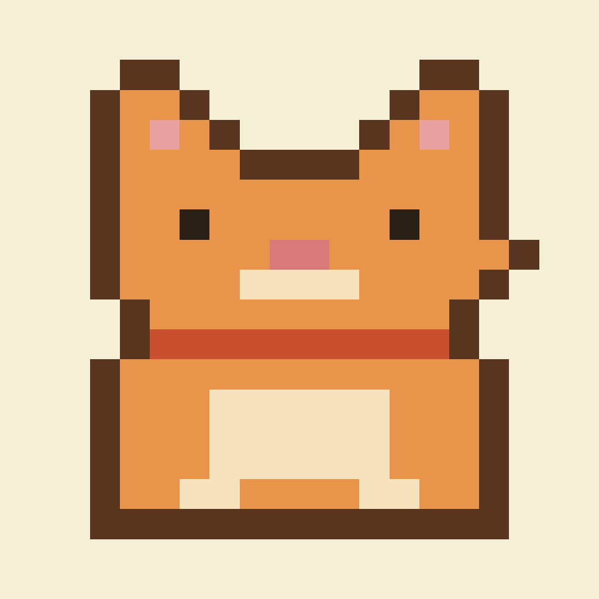

<p align="center">
  
</p>

<h1 align="center">Catshelf</h1>

<p align="center"><strong>All your AI coding accounts and their sessions in one window: one pixel cat per account.</strong></p>

<p align="center">
  <a href="LICENSE"></a>
  
  
</p>

<p align="center"><a href="#catshelf猫架中文说明">中文说明</a></p>

Catshelf (Chinese 猫架; formerly AgentDesk) is a desktop app for macOS and Windows. It keeps the AI coding clients you already use (Claude, Claude CLI, Codex, Cursor, Kimi Code, Kimi Work, DSH, OpenCode, Gemini CLI, Qwen Code), each of your accounts on them, and their local session history in one window. It opens the official client for the account you pick. It does not run agents itself, and it never stores passwords or tokens.

## Status

The source is version `0.10.1-preview.1`, a Preview. There is **no public Preview matching this source** yet (unsigned test builds are a separate thing, see below): publishing one needs signing and notarization credentials, a release tag and clean-machine checks that have not been done (see [docs/RELEASING.md](docs/RELEASING.md)). What has been checked, and how, is in the [validation ledger](docs/VALIDATION.md). Personal Mesh is attended only; public NAT/TURN, disconnect recovery and the macOS/Windows permission matrix are still open.

## Download and install

When a matching Preview passes the release gate, [GitHub Releases](https://github.com/shuqianglin1997/catshelf/releases) will contain exactly:

- macOS: `Catshelf-<version>-universal.dmg`
- Windows: `Catshelf-<version>-portable-x64.exe`
- checksums: `SHA256SUMS.txt`

> Security note: do not install the old v0.9.0 macOS image; Apple reports that unsigned package as revoked. Use a current signed and notarized release.

On macOS, move Catshelf.app into `/Applications` and open it normally. On Windows, run the portable `.exe`; see [docs/WINDOWS.md](docs/WINDOWS.md) for Store/MSIX paths.

**Unsigned test builds.** Until the signed Preview exists, Releases also has prereleases titled “Unsigned test build” (tags starting with `test-`): a universal macOS DMG and a Windows portable `.exe` with `-unsigned` in their names, plus `SHA256SUMS.txt`. They are built on GitHub from the commit named in their notes and are not signed or notarized. On macOS the first launch is blocked: open System Settings → Privacy & Security and click **Open Anyway**; do not use other workarounds. On Windows, at the SmartScreen prompt choose **More info**, then **Run anyway**.

Your accounts, settings and device keys live in a data folder that keeps the old name: `~/Library/Application Support/AgentDesk` on macOS, `%APPDATA%\AgentDesk` on Windows.

## If something goes wrong

Packages built from this source on record which commit they were built from (older ones don't). Run the package's command line (no window opens):

```bash
/Applications/Catshelf.app/Contents/MacOS/Catshelf --cli capabilities
```

`data.build` in the output gives the version, the exact commit, whether the package had uncommitted changes, and the repository. On macOS, **About Catshelf** shows the same. Put that and what happened into an issue, or hand both to your AI assistant: [docs/FIX_AND_REBUILD.md](docs/FIX_AND_REBUILD.md) tells it how to fetch exactly that source, fix the problem, and build and install a new copy on your computer without touching your data.

## What it does

- **Accounts as cats.** Each account is a cat on a shelf, with its activity (working, waiting, resting), five quota pips and the one thing it needs from you. Pick a cat to see its sessions, or **All**.
- **Add accounts four ways** (Recruit): a new isolated account signed in through the official client; bring back accounts already on this computer; drop a data folder or sign-in file; or let an AI do it through the command line. Pasted keys go straight to that account's own client.
- **One session list.** Search and sort local sessions from every client. Copy session info (path and coordinate only), open the folder, export as Markdown, mark new replies and colour tags. Compaction and sub-agent records never show up as extra sessions.
- **Several accounts per client.** Each account has its own data folder, so work and personal sign-ins don't collide; the same login used by a desktop app and a CLI stays one cat.
- **Your other computers (attended).** Pair your own devices, see their sessions, send a session's location or files, hand a whole task over as an encrypted package, and view or control another screen with consent on that screen.
- **Background runs, only when you allow them.** An AI working in one of your accounts can ask Catshelf to relay a run to another account you switched on. Catshelf never starts, queues or schedules runs by itself.
- **Tools and diagnostics.** See which clients and CLIs are installed, update a CLI when you click, and inspect launch paths and data locations.

## What it does not do

It does not embed a chat or terminal, run task queues or orchestrate agents, register arbitrary commands, offer a remote shell, or store passwords, tokens or browser credentials. Sign-in stays inside the official clients. The window runs with context isolation, no Node integration and the Chromium sandbox; files and processes are handled only by the main process.

## Build from source

Requires Node.js 22.12 or newer. macOS builds also need the Xcode command line tools; Windows builds need the Visual Studio C++ build tools.

```bash
npm ci
npm start              # run from source
npm test               # all Node tests
npm run check          # syntax and type check
npm run check:docs     # documentation and validation ledger

npm run build:mac:dir  # local test build (ad-hoc signed), release/mac-arm64/ (Intel: release/mac/)
npm run build:win      # Windows portable, release/
npm run build:mac      # signed and notarized release; credentials required
```

A build you make yourself runs on your own computer. This project publishes only the signed Preview and the labelled unsigned test builds that GitHub builds from a tagged commit, both described in [docs/RELEASING.md](docs/RELEASING.md).

## For AI assistants

- Fixing a problem for someone who installed Catshelf: [docs/FIX_AND_REBUILD.md](docs/FIX_AND_REBUILD.md).
- Using Catshelf from the command line (accounts, sessions, background runs): [docs/AI_INTERFACE.md](docs/AI_INTERFACE.md), starting with `--cli capabilities` on a package or `node src/automation/cli.js capabilities` in the source.
- Changing the code: [AGENTS.md](AGENTS.md) and [docs/STRUCTURE.md](docs/STRUCTURE.md). Only the owner pushes to this repository.

## Documentation

Start at the [documentation map](docs/README.md). Product facts: [docs/PRODUCT.md](docs/PRODUCT.md). Code: [docs/STRUCTURE.md](docs/STRUCTURE.md) and [docs/INTERNAL.md](docs/INTERNAL.md). Devices and Personal Mesh decisions: [docs/PERSONAL_AGENT_MESH_PLAN.md](docs/PERSONAL_AGENT_MESH_PLAN.md). The rename and the names that must not change: [docs/RENAME_PLAN.md](docs/RENAME_PLAN.md).

## License

[MIT](LICENSE) © hupo. The bundled Fusion Pixel font is under the SIL Open Font License (see `assets/fonts/`). Client names and colours only indicate which client a cat belongs to; they are not logos and imply no affiliation with those vendors.

---

# Catshelf（猫架）中文说明

猫架（Catshelf，原名 AgentDesk）是 macOS 和 Windows 上的桌面应用：把你已经在用的 AI 编程客户端（Claude、Claude CLI、Codex、Cursor、Kimi Code、Kimi Work、DSH、OpenCode、Gemini CLI、Qwen Code）、你在它们上面的每个账号，以及本机的会话记录放进同一个窗口。选一个账号就打开它的官方客户端。猫架自己不跑 Agent，也不保存密码和令牌。

## 现在的状态

源码版本是 `0.10.1-preview.1`，属于 Preview。目前**还没有与这份源码对应的公开 Preview**（未签名测试版是另一回事，见下）：发布需要的签名与公证凭据、发布 tag 和干净机器上的安装检查都还没做（见 [docs/RELEASING.md](docs/RELEASING.md)）。做过哪些检查、怎么做的，记在[验证记录](docs/VALIDATION.md)。设备网只做有人值守；公网 NAT/TURN、断网恢复和 macOS/Windows 权限矩阵仍未完成。

## 下载与安装

对应的 Preview 通过发布门禁后，[GitHub Releases](https://github.com/shuqianglin1997/catshelf/releases) 里只有三个文件：macOS 的 `Catshelf-<版本>-universal.dmg`、Windows 的 `Catshelf-<版本>-portable-x64.exe`，以及校验文件 `SHA256SUMS.txt`。不要安装旧的 v0.9.0 macOS 镜像（苹果已将这个未签名的包标为吊销）。

macOS 上把 Catshelf.app 拖进“应用程序”后正常打开；Windows 上直接运行 portable 版 `.exe`，Store/MSIX 的路径说明见 [docs/WINDOWS.md](docs/WINDOWS.md)。

**未签名测试版。** 签名的 Preview 出来以前，Releases 里还有标题为“未签名测试版”的预发布（标签以 `test-` 开头）：一个 macOS 通用 DMG 和一个 Windows portable `.exe`，文件名里带 `-unsigned`，另有 `SHA256SUMS.txt`。它们在 GitHub 上用说明里写的那个提交打出来，没有签名和公证。macOS 第一次打开会被拦下：到“系统设置 → 隐私与安全性”点“仍要打开”，不要用别的办法绕过；Windows 在 SmartScreen 提示时点“更多信息 → 仍要运行”。

账号、设置和设备网的钥匙放在沿用旧名的数据目录里：macOS 是 `~/Library/Application Support/AgentDesk`，Windows 是 `%APPDATA%\AgentDesk`。

## 用着出了问题

从这份源码起打的安装包都记着自己是用哪个提交打的（更早的包没有）。运行它自带的命令行（不会打开窗口）：

```bash
/Applications/Catshelf.app/Contents/MacOS/Catshelf --cli capabilities
```

输出里的 `data.build` 写着版本、确切的提交号、打包时有没有未提交的改动，以及源码仓库；macOS 的“关于 Catshelf”里也有。把这些和出了什么问题一起写进 issue，或者交给你的 AI 助手：[docs/FIX_AND_REBUILD.md](docs/FIX_AND_REBUILD.md) 告诉它怎么取回同一份源码、修好问题，再在你的电脑上打包装好，不动你的数据。

## 能做什么

- **一个账号一只猫。** 猫坐在搁板上，姿势和状态灯说它在干活、在等还是在休息，五格能量是可信的额度，名牌下面写着它需要你做的一件事。点一只猫看它的会话，点“全部”看所有会话。
- **四种方式招募账号：** 新来一只（新建独立账号，在官方客户端里登录）、把已有的领回来、把数据目录或登录文件拖进来、交给 AI 用命令行办。粘贴的密钥直接交给那个账号自己的客户端。
- **一张会话表。** 搜索、排序各客户端的本机会话；复制会话信息（只有路径和坐标）、打开目录、导出 Markdown；标出新回复、打颜色标签。上下文压缩和子代理的记录不会变成多出来的会话。
- **一个客户端多个账号。** 每个账号有自己的数据目录，工作号和个人号互不覆盖；同一个登录的桌面版和命令行版仍是一只猫。
- **你的其他电脑（有人值守）。** 配对自己的设备，查看它们的会话，发送会话位置或文件，把一整件事打成加密任务包交出去；查看或控制另一台电脑的屏幕需要那台电脑当场同意。
- **后台对话，只在你允许时。** 你在某个账号里用的 AI 可以通过猫架请你打开过开关的另一个账号在后台跑一段对话；猫架自己从不发起、排队或定时。
- **工具与诊断。** 看装了哪些客户端和命令行工具，点一下才更新命令行工具，查看启动路径和数据位置。

## 不做什么

不内嵌聊天或终端，不做任务队列或 Agent 编排，不登记任意命令，不提供远程 Shell，不保存密码、令牌或浏览器凭据。登录留在官方客户端里。窗口开启上下文隔离、关闭 Node 集成并启用 Chromium 沙箱，文件和进程只由主进程处理。

## 从源码构建

需要 Node.js 22.12 或更新。macOS 打包还需要 Xcode 命令行工具，Windows 打包需要 Visual Studio 的 C++ 构建工具。

```bash
npm ci
npm start              # 从源码运行
npm test               # 全部 Node 测试
npm run check          # 语法与类型检查
npm run check:docs     # 文档与验证记录

npm run build:mac:dir  # 本机测试包（本机签名），release/mac-arm64/（Intel 是 release/mac/）
npm run build:win      # Windows portable，输出在 release/
npm run build:mac      # 签名并公证的发布包，需要凭据
```

自己打的包在自己的电脑上用；本项目对外只发签名的 Preview，以及 GitHub 按打了标签的提交打出、明确标注的未签名测试版，两者都写在 [docs/RELEASING.md](docs/RELEASING.md) 里。

## 给 AI 助手

- 帮装了猫架的人修问题：[docs/FIX_AND_REBUILD.md](docs/FIX_AND_REBUILD.md)。
- 用命令行操作猫架（账号、会话、后台对话）：[docs/AI_INTERFACE.md](docs/AI_INTERFACE.md)，安装包上从 `--cli capabilities` 开始，源码里从 `node src/automation/cli.js capabilities` 开始。
- 改代码：[AGENTS.md](AGENTS.md) 和 [docs/STRUCTURE.md](docs/STRUCTURE.md)。只有仓库所有者向这个仓库推送。

## 文档

从[文档导航](docs/README.md)开始。产品事实见 [docs/PRODUCT.md](docs/PRODUCT.md)；代码见 [docs/STRUCTURE.md](docs/STRUCTURE.md) 和 [docs/INTERNAL.md](docs/INTERNAL.md)；设备网的决策见 [docs/PERSONAL_AGENT_MESH_PLAN.md](docs/PERSONAL_AGENT_MESH_PLAN.md)；改名以及不能改的名字见 [docs/RENAME_PLAN.md](docs/RENAME_PLAN.md)。

## 许可

[MIT](LICENSE) © hupo。随附的 Fusion Pixel 字体采用 SIL Open Font License（见 `assets/fonts/`）。客户端名字和颜色只用来表示猫属于哪个客户端，不是标志，也不表示与这些厂商有关联。
